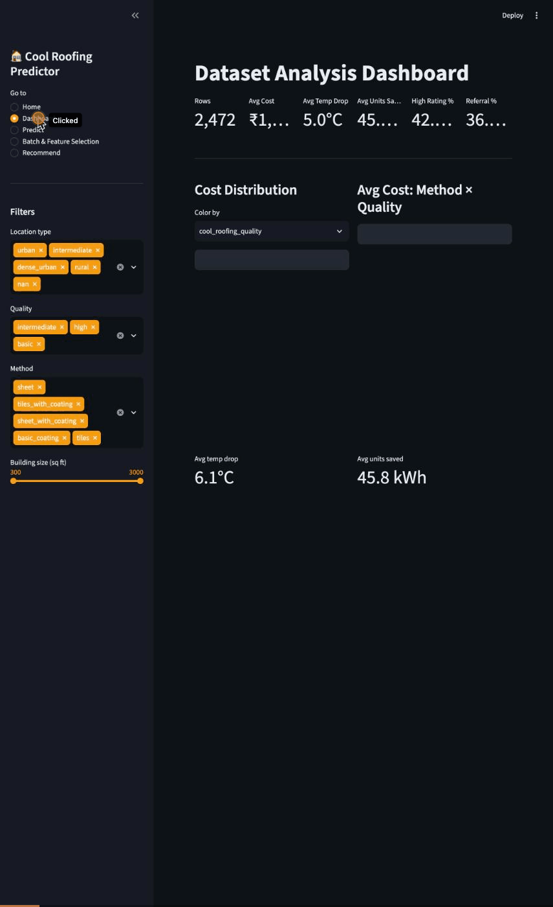

<p align="center">
  
</p>

<p align="center">
  <a href="https://cool-roofing-hackathon-4dpu4uz5vqyrh8nkyoxzex.streamlit.app/">
    
  </a>
</p>

<p align="center">
  
  
  
  
  
  
</p>

<p align="center">
  <b>Predict 5 outcomes of a cool roofing installation — before a single tile is placed.</b><br/>
  9 inputs → 5 ML predictions in under 1 second.
</p>

---

## 🎬 Demo

<p align="center">
  
</p>

---

## ⚡ Results at a Glance

| Prediction | Model | Score |
|:---|:---|:---|
| 💰 Installation Cost | XGBoost | **R² = 0.9843** · MAE ₹69,426 |
| 🌡️ Temperature Drop | Random Forest | R² = 0.935 · MAE 0.46°C |
| ⚡ Monthly Units Saved | Random Forest | R² = 0.944 · MAE 5.41 kWh |
| ⭐ High Rating (≥4★) | RF Classifier | 65.5% accuracy · AUC 0.728 |
| 🔁 Customer Referral | RF Classifier | 62.0% accuracy · F1 0.505 |

> **Live example:** 900 sqft urban building, tiles method, basic quality →
> predicted **₹3,10,742** vs actual **₹3,13,700** = **0.94% error**

---

## 📋 Table of Contents

- [The Problem](#-the-problem)
- [How It Works](#-how-it-works)
- [Model Selection](#-model-selection)
- [Dataset](#-dataset)
- [Models](#-models)
- [App — 5 Pages](#-app--5-pages)
- [Quick Start](#-quick-start)
- [File Structure](#-file-structure)
- [Key Numbers](#-key-numbers)
- [Tech Stack](#-tech-stack)

---

## ❓ The Problem

Building owners commit **₹1L to ₹18L** on cool roofing installations with:

- ❌ No pre-install cost estimate
- ❌ No energy savings forecast
- ❌ No temperature drop prediction
- ❌ 15 method × quality combos chosen by gut, not data

**We solve all four with one ML system.**

---

## ⚙️ How It Works

```
9 building inputs
      │
      ▼
┌─────────────────────────────────────┐
│  Feature Engineering                │
│  9 raw features → 22 model features │
│  (one-hot encoding + cleaning)      │
└─────────────────────────────────────┘
      │
      ├──▶ XGBoost        → Installation Cost
      ├──▶ Random Forest  → Temperature Drop
      ├──▶ Random Forest  → Units Saved/month
      ├──▶ RF Classifier  → High Rating probability
      └──▶ RF Classifier  → Referral probability
```

**Inputs:** `building_size` · `building_age` · `num_ac_units` · `avg_roof_temp_before` · `avg_units_before` · `location_type` · `roofing_type` · `cool_roofing_method` · `quality`

---

## 🏆 Model Selection

<p align="center">
  
</p>

### Why XGBoost for Installation Cost?

Cost distribution is **right-skewed** (₹55K–₹50.5L) with **non-linear** interactions between quality, size, and location. XGBoost builds 2,000 trees sequentially — each one corrects the errors of the previous — handling these patterns better than a single-pass algorithm.

| Algorithm | Cost R² | Cost MAE | Decision |
|:---|:---:|:---:|:---:|
| **XGBoost** | **0.9843** | **₹69,426** | ✅ Selected |
| Random Forest | 0.9797 | ₹72,100 | ❌ |
| Linear Regression | ~0.82 | ~₹2,10,000 | ❌ Too simple |
| Mean (baseline) | 0.000 | ₹6,08,878 | ❌ |

**XGBoost is 8.8× better than the baseline and +0.46 R² points over Random Forest.**

### Why Random Forest for Everything Else?

Temperature drop, units saved, rating, and referral targets are **smoother and less skewed** — Random Forest handles these well without the extra tuning complexity of XGBoost. It also natively supports `class_weight='balanced'` for the imbalanced classifier tasks.

### Why Not Deep Learning?

2,472 rows is too small for neural networks. Ensemble tree methods consistently outperform neural nets on **tabular data at this scale** — this is well-established in the ML literature.

---

## 📊 Dataset

<details>
<summary><b>Click to expand dataset details</b></summary>

- **2,500** building records (`cool_roofing_data.csv`)
- **Split:** 70% train (1,730) / 15% val (371) / 15% test (371)
- **Seed:** `random_state=42` for reproducibility
- **Cleaning:** 106 missing values filled with training medians; 32 sensor-error rows (temp=120°C) → NaN
- **After cleaning:** 2,472 usable rows

| Feature | Type | Notes |
|---|---|---|
| building_size | Numeric | sq ft, range 300–3,000 |
| building_age | Numeric | years, range 1–50 |
| num_ac_units | Numeric | 0–10 |
| avg_roof_temp_before | Numeric | °C, normal range 30–80 |
| avg_units_before | Numeric | kWh/month |
| location_type | Categorical | urban/rural/intermediate/dense_urban |
| roofing_type | Categorical | concrete_flat/concrete_slanted/tiles/sheet |
| cool_roofing_method | Categorical | 5 methods |
| quality | Categorical | basic/intermediate/high |

</details>

---

## 🤖 Models

<details>
<summary><b>XGBoost — Installation Cost</b></summary>

```python
XGBRegressor(
    n_estimators=2000,    # 2000 sequential correction trees
    max_depth=5,          # prevents over-complex trees
    learning_rate=0.06,   # small step = stable, no overcorrecting
    reg_lambda=0.5,       # L2 penalty prevents overfitting
    subsample=0.9         # 90% row sampling per tree = diversity
)
```

- Training R² = 0.997 · Test R² = 0.9843 → **1.3% gap** (healthy, not overfit)
- MAE ₹69,426 vs baseline ₹6,08,878 → **8.8× improvement**

</details>

<details>
<summary><b>Random Forest — Temperature, Units, Rating, Referral</b></summary>

```python
RandomForestRegressor / RandomForestClassifier(
    n_estimators=300,         # 300 independent trees
    max_depth=12,             # captures complex patterns
    class_weight='balanced'   # handles class imbalance (classifiers only)
)
```

Top feature importances:

| Model | Top Feature | Importance | Why it makes sense |
|---|---|---|---|
| Temp Drop | avg_roof_temp_before | ~0.40 | Higher start → bigger drop |
| Units Saved | avg_units_before | ~0.44 | More usage → more savings |
| High Rating | avg_units_before | ~0.18 | Visible savings → happy customers |

</details>

<details>
<summary><b>Hyperparameter Tuning</b></summary>

`RandomizedSearchCV` — 40 iterations × 5-fold CV = **200 model fits per task**

Models saved as `.joblib` — load in ~50ms vs ~2s retraining.

</details>

---

## 🖥️ App — 5 Pages

| Page | What it does |
|:---|:---|
| 🏠 **Home** | Live KPIs at startup, all 5 model status indicators |
| 📊 **Dashboard** | 8 Plotly charts, 4 simultaneous filters |
| 🔮 **Predict** | 9 inputs → 5 predictions + payback period |
| 📦 **Batch** | Upload CSV → 2,500 rows in **0.23 seconds** |
| 🏆 **Recommender** | Ranks all 15 method × quality combos by weighted score |

Recommender weights: cost (−0.25) · temp drop (+0.25) · units saved (+0.25) · rating (+0.15) · referral (+0.10)

---

## 🚀 Quick Start

```bash
git clone https://github.com/sxrxvxnn/Cool-Roofing-Hackathon.git
cd Cool-Roofing-Hackathon
pip install -r requirements.txt

# Streamlit app
streamlit run app.py

# FastAPI server (optional)
uvicorn main:app --reload
```

---

## 📁 File Structure

```
Cool-Roofing-Hackathon/
├── app.py                    # Streamlit app (5 pages)
├── main.py                   # FastAPI server
├── cool_roofing.ipynb        # EDA + training notebook
├── cool_roofing_data.csv     # Dataset (2,500 rows)
├── requirements.txt
├── assets/
│   ├── header.svg            # Animated header banner
│   └── model_comparison.svg  # Animated model comparison chart
├── models/
│   ├── model_cost.joblib           # XGBoost — R² 0.9843
│   ├── model_temp_drop.joblib      # RF — R² 0.935
│   ├── model_units_saved.joblib    # RF — R² 0.944
│   ├── model_high_rating.joblib    # RF — 65.5% acc
│   ├── model_referral.joblib       # RF — 62.0% acc
│   └── features_*.joblib           # Feature lists + encoders
├── templates/                # FastAPI HTML templates
├── README.md
├── CONTRIBUTING.md
└── LICENSE
```

---

## 📈 Key Numbers

<table>
<tr><td><b>Cost R² (test set)</b></td><td>0.9843</td></tr>
<tr><td><b>Cost MAE</b></td><td>₹69,426</td></tr>
<tr><td><b>Baseline MAE</b></td><td>₹6,08,878</td></tr>
<tr><td><b>MAE improvement over baseline</b></td><td><b>8.8×</b></td></tr>
<tr><td><b>Batch prediction speed</b></td><td>2,500 rows / 0.23s</td></tr>
<tr><td><b>Live example error</b></td><td>0.94%</td></tr>
<tr><td><b>Average installation cost</b></td><td>₹10.9L</td></tr>
<tr><td><b>Average temperature drop</b></td><td>8.1°C</td></tr>
<tr><td><b>Average monthly savings</b></td><td>46 kWh ≈ ₹322/month</td></tr>
<tr><td><b>Average payback period</b></td><td>~2.6 years</td></tr>
</table>

---

## 🛠️ Tech Stack

<p>
  
  
  
  
  
  
  
  
</p>
